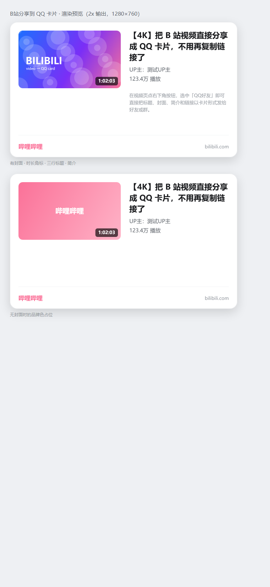

# B站分享到QQ卡片（Bilibili → QQ Card）

在 B 站网页版视频页，把视频以**卡片**（封面 + 标题 + UP主 + 播放量 + 简介 + 链接）的形式直接分享到 QQ，
而不是复制一条裸链接。交互参照手机端 B 站的分享面板。

> 版本 1.0.1 · Chrome 及其他 Chromium 内核浏览器（MV3，Chrome 110+）· [MIT 协议](LICENSE)
>
> **不碰 QQ 客户端**：纯浏览器扩展，不注入、不读取聊天记录、不破解任何私有接口。



---

## 它到底能做到什么

浏览器扩展**没有**调用 QQ 客户端私有接口的能力，所以「真·卡片」走的是 QQ 官方分享组件
（`connect.qq.com/widget/shareqq`）：点「QQ好友」会打开一个 QQ 官方小窗，选中好友/群后发出的是
**带封面和简介的卡片消息**，与手机端效果一致。

四种分享方式，按需选：

| 动作 | 结果 | 适用场景 |
| --- | --- | --- |
| **QQ好友**（推荐） | 打开 QQ 官方分享页 → 选好友/群 → 发卡片 | 电脑上发 QQ 好友/群 |
| 复制卡片 | 剪贴板写入富文本卡片（HTML）+ 纯文本兜底 | 粘到 QQ / 微信 / 邮件正文，保留缩略图与排版 |
| 保存图片 | 本地渲染 640×380（导出 1280×760）PNG 卡片 | 发图更稳、可存档、可发到任何 IM |
| 复制链接 | 标题 + 链接纯文本 | 最轻量的兜底 |

---

## 安装

1. 取代码：从 [Releases](https://github.com/kan2053/bilibili-share-to-qq/releases) 下载
   `bilibili-share-to-qq-1.0.1.zip` 解压，或 `git clone https://github.com/kan2053/bilibili-share-to-qq.git`。
2. 浏览器地址栏打开 `chrome://extensions`。
3. 右上角打开「开发者模式」。
4. 点「加载已解压的扩展程序」，选择含 `manifest.json` 的那一层目录。
5. 打开任意 B 站视频页（`bilibili.com/video/…` 或番剧 `bangumi/play/…`）。

> 扩展没有上架商店，所以是「已解压加载」方式；浏览器重启后仍会保留。更新时把新代码覆盖过去，
> 再在 `chrome://extensions` 点一下「重新加载」。

## 使用

三种唤起方式：

- 视频页**右下角粉色悬浮按钮**（悬停在播放器右侧，不挡弹幕）；
- 快捷键 **`Alt + Shift + B`**（可在 `chrome://extensions/shortcuts` 改成自己习惯的）；
- 点浏览器工具栏上的扩展图标。

面板从上到下依次是：封面缩略图 → 标题 → UP主 / 播放量 / 时长 → 四宫格动作 → 提示。

## 卡片长什么样

`test/out/card-preview.png` 是渲染预览（由 `test/preview.html` 无头浏览器生成）：

- 左侧封面 288×162，右下角叠时长角标；
- 右侧标题最多 3 行（按像素宽度断行，中文按字、英文按词），超出以 `…` 收尾；
- 元信息一行：`UP主：xxx · 12.3万播放 · 3:21`；
- 简介最多 3 行；底部一条分隔线 + B 站粉色 logo 字 + `bilibili.com`；
- 整卡 640×380 逻辑像素，PNG 按 2× 导出（1280×760），圆角外透明。

## 实现要点（想改代码时看这段）

```
bilibili-share-to-qq/
├─ manifest.json          MV3 声明：content script 注入范围、DNR 静态规则、快捷键
├─ rules/headers.json     DNR：给 hdslb.com 图片请求补 Referer，绕开 CDN 防盗链
├─ icons/                 16/32/48/128 图标（tools/make-icons.mjs 纯 Node 生成）
├─ src/core.js            纯逻辑：URL/标题/计数解析、分享文案、QQ 分享 URL、卡片排版指令
├─ src/card.js            Canvas 渲染：把排版指令画成图，导出 PNG
├─ src/panel.js           Shadow DOM 分享面板（隔离 B 站样式）+ 悬浮按钮 + toast
├─ src/content.js         抓取页面信息、SPA 路由适配、剪贴板/下载动作
├─ src/background.js      Service Worker：弹 QQ 分享窗、抓封面转 data URL、下载兜底
├─ test/                  单测 + 无头浏览器自测页（见下）
└─ tools/make-icons.mjs   图标生成脚本
```

关键取舍：

- **封面走 data URL**：页面里的 `` 跨域会污染 canvas，所以由 Service Worker `fetch` 封面再转 base64；
  同时 DNR 静态规则给它补 `Referer: https://www.bilibili.com/`，否则 `i0.hdslb.com` 会 403。
- **剪贴板里的 HTML 卡片不内嵌图片**：用公网 `pics` 地址，避免剪贴板体积爆炸、粘贴卡顿。
- **整卡排版是「绘制指令」而非直接画**：`core.js` 产出 `layoutCard()` 的 ops（roundRect/image/text/badge/line），
  `card.js` 才消费它。因此排版可以在 Node 里单测（不依赖浏览器），Canvas 只负责落地。
- **面板用 Shadow DOM**：B 站自己的 CSS 重置很激进，`all: initial` + 影子树能彻底隔离；
  宿主挂在 `documentElement` 上，B 站替换 `body` 时也不会丢。
- **SPA 适配**：B 站切视频不整页刷新，所以劫持 `pushState/replaceState` + 每 1.2s 比对一次 URL/标题，
  变化即重建载荷；面板被移除会自动补挂。

## 权限说明

| 权限 | 用途 |
| --- | --- |
| `downloads` | 保存卡片 PNG |
| `declarativeNetRequest` + `https://*.hdslb.com/*` | 仅给图片请求补 Referer，让封面能抓成 base64 |
| `content_scripts`（bilibili.com 视频页） | 注入悬浮按钮与面板 |

不请求 `tabs`/`cookies`/`storage`，不读取聊天记录，不发任何数据到第三方服务器（除你主动点「QQ好友」跳转的 QQ 官方页）。

## 变更记录

### 1.0.1 —— 修复「装上后整页都点不动」

**现象**：加载扩展并刷新后，B 站页面所有按钮、链接、播放器全部无响应。

**原因**：面板的遮罩层 `.bqq-mask` 是 `position:fixed;inset:0`（全屏），代码为了让「点遮罩关闭」可用，
在创建时写了 `mask.style.pointerEvents = 'auto'`。面板关闭时遮罩只是 `opacity:0` —— **视觉上不可见，但仍然在
最顶层接收所有鼠标事件**，于是整页点击都被它吃掉。这是典型的「透明覆盖层」事故。

**修复**：

1. 关闭态遮罩/弹层一律 `visibility:hidden + pointer-events:none`，只有 `data-open="1"` 时才
   `visibility:visible + pointer-events:auto`（同时把 `backdrop-filter` 也收进打开态）；
2. 删掉三处内联 `pointer-events`（内联优先级高于 CSS，会让状态切换失效）；
3. 悬浮按钮的可点性改由 CSS 控制，`data-hidden="1"` 时真正 `pointer-events:none`（此前内联 `auto` 会覆盖它，
   留下一个透明但仍可点击的 46×46 热区）；
4. `show()` 不再等 `requestAnimationFrame` 置位，后台标签页 rAF 被节流时面板会「点了没反应」；
5. 宿主元素始终保持 `pointer-events:none`，只有按钮/弹层/打开态遮罩恢复可点。

**防回归**：`test/harness.html` 新增穿透性断言——面板关闭时用 `document.elementFromPoint()` 逐点命中，
并真实点击页面按钮计数；打开面板时遮罩必须接管；关闭后页面必须恢复可点。这三条现在与卡片像素断言一起跑。

> 已装旧版本的话：`chrome://extensions` → 本扩展 → 点「重新加载」，然后刷新 B 站页面。

## 已知道路与限制

- **必须登录 QQ**：QQ 官方分享页需要登录/扫码才能发送；未登录时只能看到「手机QQ扫码」。
- **`pics` 要公网可访问**：卡片封面用的是 B 站 CDN 原图地址（已剥掉 `@672w_378h_1c.webp` 尺寸后缀）。
- **B 站改版可能失效**：选择器集中在 `src/content.js` 顶部的 `readTitle/readUp/readPlay/readCover/readDesc`，
  失效时只改这几个函数；JSON-LD/`og:` 兜底已经内置。
- **不支持 Edge 之外的非 Chromium 浏览器**：Firefox 需另行适配 `browser.*` 与 MV2/MV3 差异（本次未做）。
- 番剧页（`bangumi/play/`）字段名不同，已做 `mediainfo_*` 兜底，但 EP 列表分集切换时播放量可能取不到。

## 测试

```powershell
# 1) 纯逻辑单测（Node，无需浏览器）
node test/core.test.mjs
node test/background.test.mjs

# 2) 面板 + 卡片渲染自测（无头 Chrome 打开真实 DOM）
node test/serve.mjs 8787      # 另开一个窗口常驻
# 再执行（PowerShell）：
#   启动 Chrome：--headless=new --no-sandbox --disable-gpu --no-proxy-server
#                --user-data-dir=<临时目录> --virtual-time-budget=8000
#                --dump-dom http://127.0.0.1:8787/video/BV1xx411c7mD
#   <title> 为 HARNESS_OK 即通过，页面里 <pre id="report"> 是逐项指标

# 3) 生成卡片预览图
#   --screenshot=test/out/card-preview.png --window-size=760,1650
#   http://127.0.0.1:8787/test/preview.html
```

本机实测（Chrome 155）：`core` 12 项、`background` 7 项单测全绿；harness 断言全部命中——
面板标题/元信息/四个动作正确，点「QQ好友」发出 `BQQ_OPEN_QQ` 且 URL 带 BV 号，
卡片画布 1280×760，封面真像素写入、圆角外透明、时长角标与页脚分隔线均按预期落位；
穿透性回归三条同时通过：`hit_closed_probe.tag=BUTTON`（页面按钮可点，`probe_clicks_closed=1`）、
`hit_open_probe.shadow=true`（面板打开时遮罩接管）、`hit_after_close.tag=BUTTON`（`probe_clicks_after_close=2`）。

## 免责声明

仅供个人学习与自用；分享内容版权归原视频作者与 B 站所有。请勿用于批量抓取或绕过平台限制。

## 许可证

[MIT](LICENSE) © 2026 kan2053
